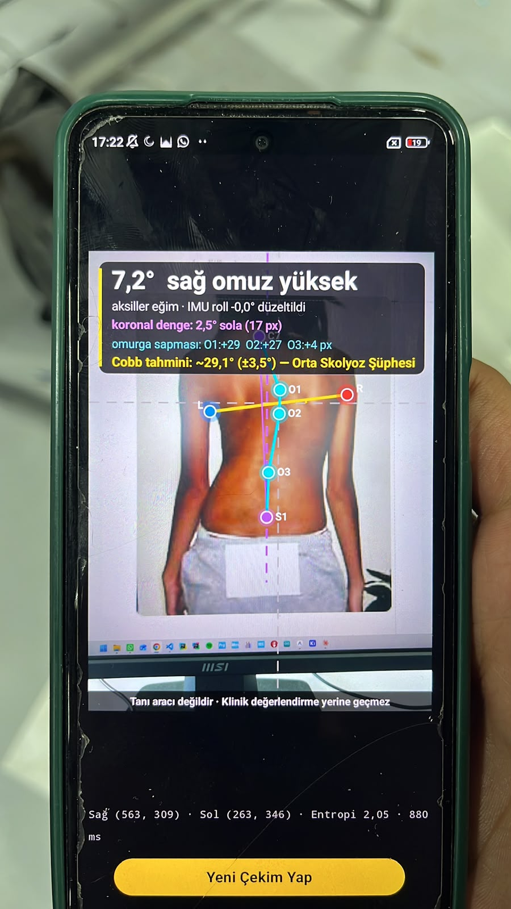
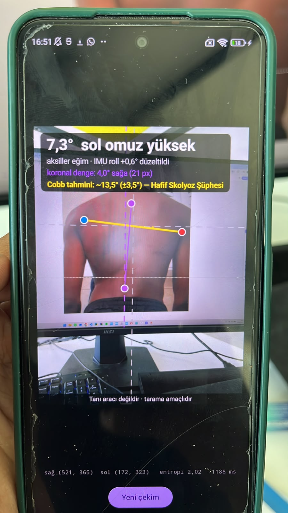
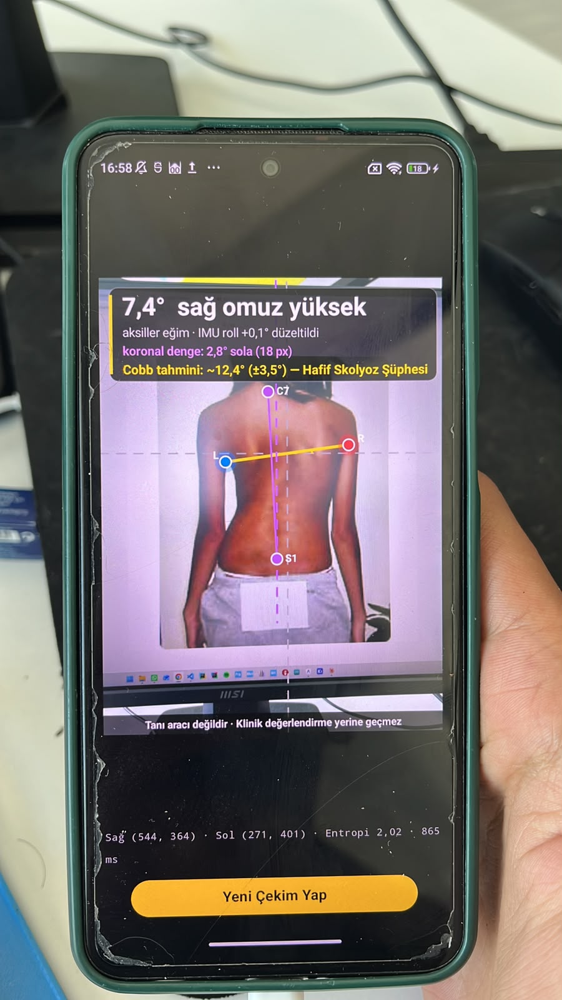

# Skolyoz — radiation-free back-asymmetry screening on a phone

**A single back photograph, analysed entirely on the phone, gives a screening
indicator for trunk asymmetry.** Seven anatomical landmarks are detected; the
**axillary tilt** and the **coronal balance** are computed from them, and the
phone's own IMU removes the error caused by holding the camera crooked. A **Cobb-angle
measurement** is also performed from these; the app shows it as "Cobb tahmini ~X° (±3.5°)".
That feature is **in the test phase** and has not been validated against radiographs.
**The system is currently in the test phase and is not an end-user product.**

🇹🇷 [Türkçe README](README.md) — the primary language of this repository. Most documents
(`docs/`, the metrics page) are in Turkish.


<table>
<tr>
<td align="center" valign="top"></td>
<td align="center" valign="top"></td>
<td align="center" valign="top"></td>
</tr>
</table>

<sub>The app running on a real phone (Android, fully on-device). The camera is pointed at back photographs shown on a monitor; there is
no live person in front of it. The **"Cobb tahmini" (Cobb estimate) line** on the screen is the system's Cobb-angle measurement.
**This feature is in the test phase:** it has not been validated against radiographs, so it does not replace a
radiographic Cobb measurement ([docs/METRICS.md](docs/METRICS.md#7-bilinen-boşluklar), gap `cobb_estimate`, Turkish). The millisecond
figure at the bottom is the app's own timer for that one shot, not a controlled latency measurement. Source
and permission of the photographs on the screens: [docs/DATA_AND_LICENSING.md](docs/DATA_AND_LICENSING.md) §1 (Turkish).</sub>

> [!WARNING]
> **This is research software and a screening aid, not a diagnostic tool.**
> **It is in the test phase and is not an end-user product.** It measures surface
> asymmetry (axillary tilt, coronal balance) and performs a Cobb-angle measurement from it;
> the Cobb measurement has not been validated against radiographs and does not replace the
> radiographic Cobb angle. It has not been validated on patients or cleared as a medical
> device. Do not use it to make clinical decisions.

## How it works

```
Photo + simultaneous IMU gravity sample
   │  resize to 640×640 (training-time stretch, reproduced exactly)
   ▼
Stage 1 — YOLO11n-pose, fine-tuned: coarse position of 7 landmarks
   ▼
Stage 2 — MobileNetV3-small + heatmap + soft-argmax, once per landmark:
          128×128 crop around the coarse point → sub-pixel position
   ▼
Map back to the original resolution; measurement in pure geometry
   ├─ axillary tilt   = atan2(Δy, |Δx|) of the two armpit points − IMU roll
   ├─ coronal balance = lateral offset of C7 from the plumb line through the sacrum
   └─ Cobb measurement = linear combination of both and the spine-point offset (test phase, unvalidated)
   ▼
Gates: |pitch| > 8° rejects the shot · low-confidence heatmaps are rejected
```

## What is in this repository

This repository is a **catalogue**: it shows what the product looks like and how it performs.
It contains no source code, tests, training data, model weights or app packages.

| Page | Contents |
|---|---|
| [docs/METRICS.md](docs/METRICS.md) (Turkish) | Accuracy, deployment, latency, robustness and **known gaps**; the status and source of every number |
| [docs/MODEL_CARD.md](docs/MODEL_CARD.md) (Turkish) | Models, intended use, out-of-scope use, limits and risks |
| [docs/ORNEKLER.md](docs/ORNEKLER.md) (Turkish) | Example outputs on a drawn figure and on one real photograph |
| [docs/DATA_AND_LICENSING.md](docs/DATA_AND_LICENSING.md) (Turkish) | Data source, privacy, permission status of the images, licence |
| [`metrics/`](metrics) | Raw performance data: `results.json` and recorded benchmark runs |

## Headline metrics

| Metric | Value | Evidence |
|---|---|---|
| Axillary-tilt error, median / p90 | 0.271° / 1.237° | reported |
| Coronal-balance error, median / p90 | 1.292° / 3.385° | reported |
| Axillary landmark error, median (label noise floor) | 3.045 px (2.45 px) | reported |
| Screening recall at ≥ 3° tilt (held-out split, n = 50) | 93.8 % (15/16; 95 % CI 71.7–98.9 %) | reported |
| Model size, both stages, float16 | 6.44 MB | measured |
| Parameters, Stage 1 / Stage 2 | 2.69 M / 0.41 M | measured |
| Model forward, 1 × Stage 1 + 7 × Stage 2 (TFLite, CPU, median / p90) | 70.8 ms / 75.7 ms — 11th Gen Intel(R) Core(TM) i7-11800H @ 2.30GHz | measured |
| Cobb-angle measurement | Performed; test phase, not validated against radiographs | unvalidated |
| Open gaps | 6 listed — see [METRICS.md (Turkish)](docs/METRICS.md#7-bilinen-boşluklar) | — |

### Charts

<picture>
  <source media="(prefers-color-scheme: dark)" srcset="docs/img/ablation-dark.svg">
  
</picture>

<picture>
  <source media="(prefers-color-scheme: dark)" srcset="docs/img/angle-dark.svg">
  
</picture>

<picture>
  <source media="(prefers-color-scheme: dark)" srcset="docs/img/decision-dark.svg">
  
</picture>

<picture>
  <source media="(prefers-color-scheme: dark)" srcset="docs/img/latency-dark.svg">
  
</picture>

Read [docs/METRICS.md](docs/METRICS.md) (Turkish) before quoting any of this: it states what
each number means, how it was obtained, how uncertain it is, and what has **not** been
measured. In short: the accuracy figures are offline experiments on a small web-sourced
image set (337 images); on-device and phone-photo accuracy are open, and the Cobb measurement
is unvalidated. The status and source of every number are recorded in
[`metrics/results.json`](metrics/results.json).

## Known limitations

1. **Domain gap.** Training images are web-sourced; phone photos come from a different
   distribution (three consecutive shots of one scene gave 1.25°, 3.37°, 6.73°). A confidence
   gate rejects unstable measurements, but the cure is phone-captured training data.
2. **No spine-curve profile.** The surface midline deviation (≈1.4 % of trunk height) is
   below the label noise; shown by measurement.
3. **The sign of the IMU roll correction is unverified.** The overlay and the formula disagree and
   the docs record no on-device check ([docs/METRICS.md](docs/METRICS.md#7-bilinen-boşluklar),
   `imu_roll_sign`); with the phone held crooked the correction may add error instead of removing it.
4. **No Cobb validation.** There is no radiograph-paired data. The app also performs a Cobb-angle
   measurement (test phase); it uses uncalibrated coefficients — see `cobb_estimate` in
   [docs/METRICS.md](docs/METRICS.md#7-bilinen-boşluklar).

## Privacy, data and licence

Inference runs on the device; the app requests no internet access, only the camera, and
disables backups. Patient photographs are not added to this repository; the app photographs
above and the reference photograph are the exceptions. The training-data source and the
permission status of the images are in [docs/DATA_AND_LICENSING.md](docs/DATA_AND_LICENSING.md) (Turkish).

**Licence: not yet chosen.** The content of this repository is all rights reserved. The app
itself and its source code are not published here.
