# Skolyoz — radiation-free back-asymmetry screening on a phone

**A single back photograph, analysed entirely on the phone, gives a screening
indicator for trunk asymmetry.** Seven anatomical landmarks are detected; the
**axillary tilt** and the **coronal balance** are computed from them, and the
phone's own IMU removes the error caused by holding the camera crooked.

🇹🇷 [Türkçe README](README.md) — the primary language of this repository. Most documents
(`docs/`, the metrics page, the research notes) are in Turkish.


<table>
<tr>
<td align="center" valign="top">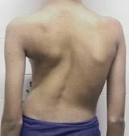<br><sub><b>Reference photograph</b><br>216×228 pixels</sub></td>
<td align="center" valign="top">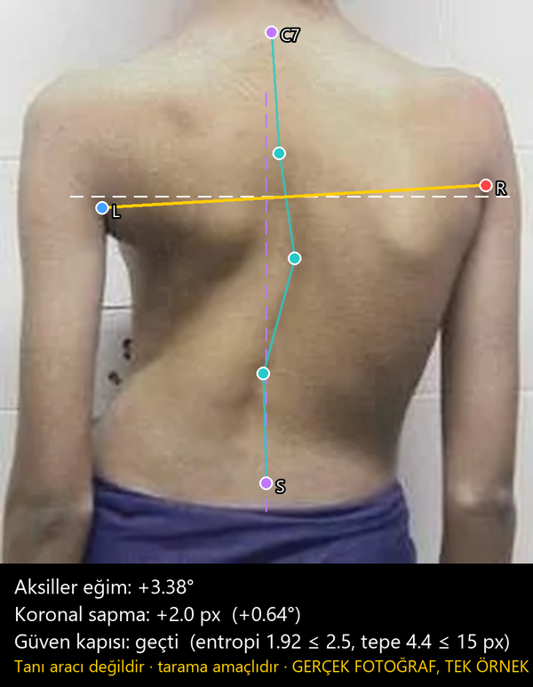<br><sub><b>Output of the models</b><br>tilt +3.38°, gate passed</sub></td>
</tr>
</table>

<sub>Left: the reference photograph. Right: what the models in this repository output on it. This is **one example, not evidence of
accuracy**: its true value is unknown and the same frame was found among the project's training images
([docs/ORNEKLER.md](docs/ORNEKLER.md), Turkish). What the app measures is this kind of visible surface asymmetry, not the
radiographic Cobb angle. Image source and permission: [docs/DATA_AND_LICENSING.md](docs/DATA_AND_LICENSING.md) §1 (Turkish).</sub>


> [!WARNING]
> **This is research software and a screening aid, not a diagnostic tool.** It
> measures *surface asymmetry*, which is **not** the radiographic Cobb angle,
> and it has not been validated on patients or cleared as a medical device.
> Do not use it to make clinical decisions.

## How it works

```
Photo (CameraX) + simultaneous IMU gravity sample
   │  resize to 640×640 (training-time stretch, reproduced exactly)
   ▼
Stage 1 — YOLO11n-pose, fine-tuned: coarse position of 7 landmarks
   ▼
Stage 2 — MobileNetV3-small + heatmap + soft-argmax, once per landmark:
          128×128 crop around the coarse point → sub-pixel position
   ▼
Map back to the original resolution; measurement in pure geometry
   ├─ axillary tilt  = atan2(Δy, |Δx|) of the two armpit points − IMU roll
   └─ coronal balance = lateral offset of C7 from the plumb line through the sacrum
   ▼
Gates: |pitch| > 8° rejects the shot · low-confidence heatmaps are rejected
```

## Example outputs

These are the shipped TFLite models run on a **drawn (synthetic) back figure**; none of these five
images shows a real person. They illustrate what the pipeline does, not how well it works: the models were trained
on real photographs, and on the drawn figure the point error is clearly larger (a drawn 5° tilt was
measured as 3.3°). Numbers and all landmarks: [docs/ORNEKLER.md](docs/ORNEKLER.md) (Turkish).

<table>
<tr>
<td align="center">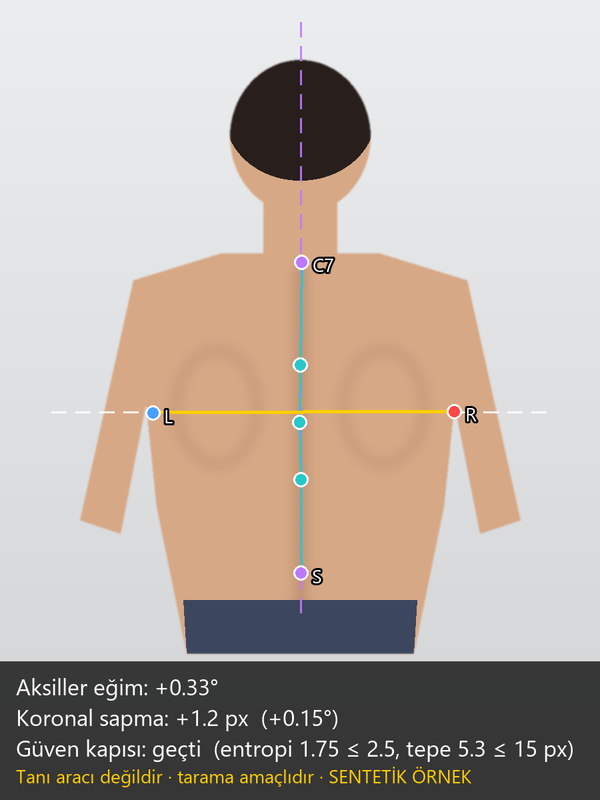<br><sub><b>Symmetric figure</b><br>tilt +0.33°, gate passed</sub></td>
<td align="center">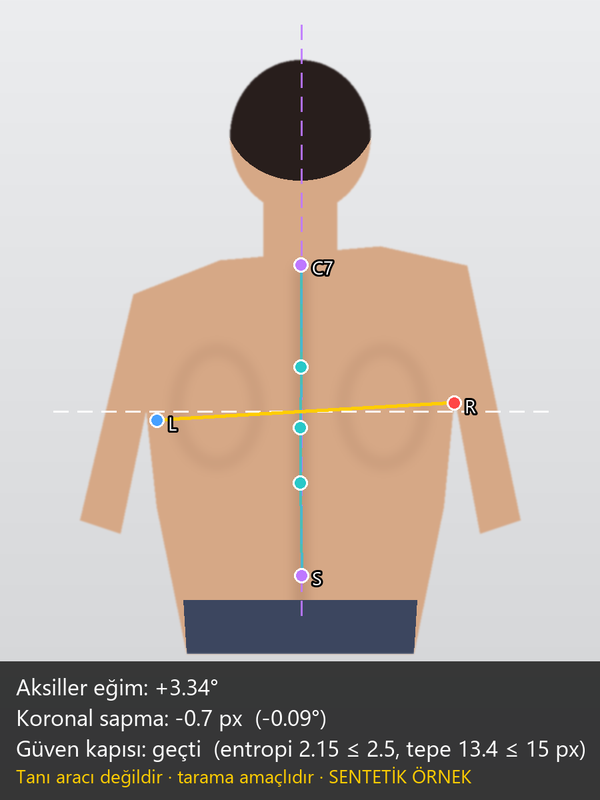<br><sub><b>Right shoulder high</b><br>drawn 5°, measured +3.34°</sub></td>
<td align="center">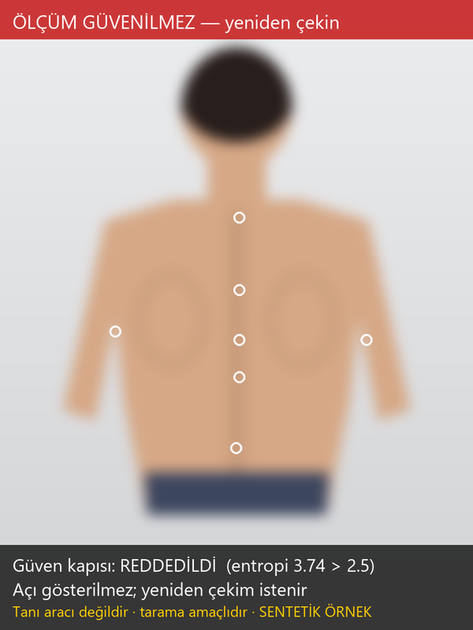<br><sub><b>Blurred shot</b><br>gate rejects (entropy 3.74)</sub></td>
</tr>
<tr>
<td align="center">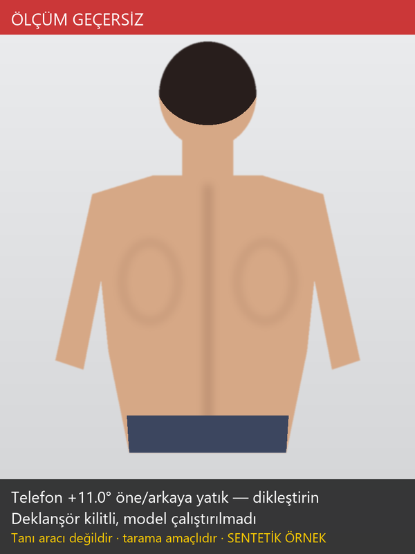<br><sub><b>Phone tilted 11°</b><br>shutter locked</sub></td>
<td align="center">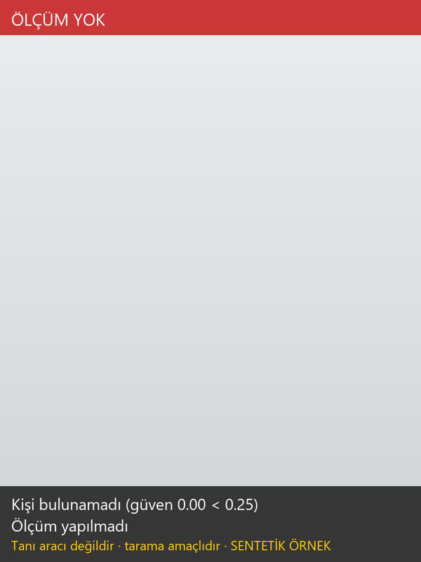<br><sub><b>Nobody in frame</b><br>no measurement</sub></td>
<td></td>
</tr>
</table>

## What is in the repository

This is the full source, not just a results page. What is deliberately **not** included:
patient images and trained model weights (see
[docs/DATA_AND_LICENSING.md](docs/DATA_AND_LICENSING.md), Turkish).

| Folder | Contents |
|---|---|
| [`android/`](android) | Kotlin app: CameraX capture, IMU gravity interpolation, TFLite inference chain, measurement maths, guide overlay; 42 JVM unit tests + 4 device tests |
| [`scripts/`](scripts) | Numbered research pipeline `00` → `52`: data cleaning, label-noise measurement, training, evaluation, ONNX/TFLite export, golden-data generation for Kotlin |
| [`skolyoz_metrics/`](skolyoz_metrics) | Maintained Python code: metrics validation/rendering and data-free benchmarks |
| [`tests/`](tests) | pytest suite (including Python-reference ↔ Kotlin golden-data parity) |
| [`metrics/`](metrics) | Single source of truth for metrics (`results.json`, schemas) and recorded benchmark runs |
| [`docs/`](docs) | Architecture, tech stack, benchmarking protocol, model card, data/licence notes, the **generated** metrics page |
| [`docs/tr/`](docs/tr) | Original Turkish technical report and working notes |

## Quick start

```bash
# tests and metrics check — no GPU, no private data
pip install -r requirements/dev.txt
python -m skolyoz_metrics check && pytest && ruff check .

# Android (JDK 17)
cd android && ./gradlew :app:testDebugUnitTest :app:assembleDebug

# data-free benchmarks (random weights / your .tflite files, synthetic input)
pip install -r requirements/bench.txt
python -m skolyoz_metrics bench arch
python -m skolyoz_metrics bench tflite --stage1 asama1.tflite --stage2 asama2.tflite
python -m skolyoz_metrics render
```

The trained model files are not distributed. To run the app, put `asama1.tflite` and
`asama2.tflite` in `android/app/src/main/assets/`.

## Headline metrics

<!-- headline:begin -->
| Metric | Value | Evidence |
|---|---|---|
| Axillary-tilt error, median / p90 | 0.271° / 1.237° | reported |
| Coronal-balance error, median / p90 | 1.292° / 3.385° | reported |
| Axillary landmark error, median (label noise floor) | 3.045 px (2.45 px) | reported |
| Screening recall at ≥ 3° tilt (held-out split, n = 50) | 93.8 % (15/16; 95 % CI 71.7–98.9 %) | reported |
| Model size, both stages, float16 | 6.44 MB | measured |
| Parameters, Stage 1 / Stage 2 | 2.69 M / 0.41 M | measured |
| Model forward, 1 × Stage 1 + 7 × Stage 2 (TFLite, CPU, median / p90) | 70.8 ms / 75.7 ms — 11th Gen Intel(R) Core(TM) i7-11800H @ 2.30GHz | measured |
| Kotlin ↔ Python parity (golden data) | 42 JVM + 4 device tests; reported diff 0.000 px / 0.0000° | reported |
| Open gaps | 6 listed — see [METRICS.md (Turkish)](docs/METRICS.md#8-bilinen-boşluklar) | — |
<!-- headline:end -->

### Charts

<!-- charts:begin -->
<picture>
  <source media="(prefers-color-scheme: dark)" srcset="docs/img/ablation-dark.svg">
  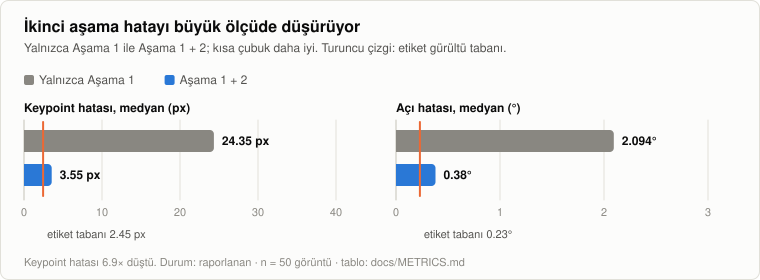
</picture>

<picture>
  <source media="(prefers-color-scheme: dark)" srcset="docs/img/angle-dark.svg">
  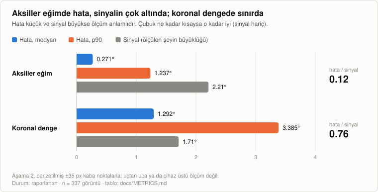
</picture>

<picture>
  <source media="(prefers-color-scheme: dark)" srcset="docs/img/decision-dark.svg">
  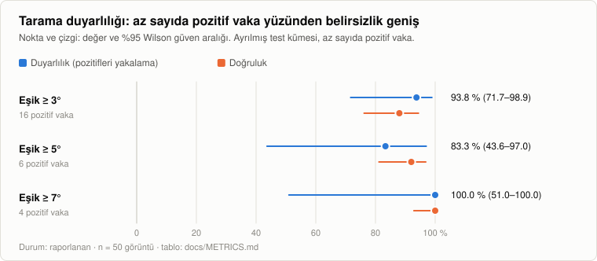
</picture>

<picture>
  <source media="(prefers-color-scheme: dark)" srcset="docs/img/latency-dark.svg">
  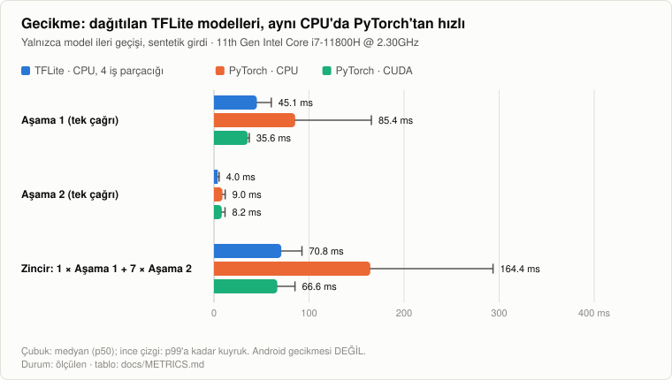
</picture>
<!-- charts:end -->

Read [docs/METRICS.md](docs/METRICS.md) (Turkish) before quoting any of this: it states what
each number means, how it was obtained, how uncertain it is, and what has **not** been
measured. In short: the accuracy figures are offline experiments on a small web-sourced
image set (337 images); on-device and phone-photo accuracy are open, and the Cobb estimate
shown in the app is unvalidated.

Every number above is generated from [`metrics/results.json`](metrics/results.json) and
[`metrics/benchmarks/`](metrics/benchmarks); CI fails if they drift apart.

## Technology

Kotlin 2.0 · Jetpack Compose + Material 3 · CameraX 1.4 · TensorFlow Lite 2.16 (float16,
4 threads) · Android min SDK 26 · Ultralytics YOLO11n-pose + torchvision MobileNetV3-small ·
PyTorch → ONNX → `onnx2tf` → TFLite · GitHub Actions. Versions:
[docs/TECH_STACK.md](docs/TECH_STACK.md).

## Known limitations

1. **Domain gap.** Training images are web-sourced; phone photos come from a different
   distribution (three consecutive shots of one scene gave 1.25°, 3.37°, 6.73°). A confidence
   gate rejects unstable measurements, but the cure is phone-captured training data.
2. **No spine-curve profile.** The surface midline deviation (≈1.4 % of trunk height) is
   below the label noise; shown by measurement.
3. **The sign of the IMU roll correction is unverified.** The overlay and the formula disagree and
   the docs record no on-device check ([docs/METRICS.md](docs/METRICS.md#8-bilinen-boşluklar),
   `imu_roll_sign`); with the phone held crooked the correction may add error instead of removing it.
4. **No Cobb validation.** There is no radiograph-paired data. The app's Cobb estimate uses
   uncalibrated coefficients — see `cobb_estimate` in
   [docs/METRICS.md](docs/METRICS.md#8-bilinen-boşluklar).

## Privacy, data and licence

Inference runs on the device; the app requests no `INTERNET` permission, only `CAMERA`, and
disables backups. Patient photographs are never committed. **Licence: not yet chosen** — until
a `LICENSE` file is added the code is "all rights reserved"; the Ultralytics (AGPL-3.0)
dependency constrains the choice. See [docs/DATA_AND_LICENSING.md](docs/DATA_AND_LICENSING.md).

## Contributing

See [CONTRIBUTING.md](CONTRIBUTING.md). One rule matters: a change that touches a number goes
through `metrics/results.json` with a status and a source.
