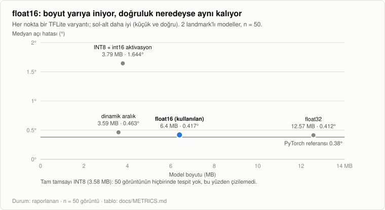

# Metrikler

<!-- `python -m skolyoz_metrics render` ile metrics/results.json ve metrics/benchmarks/*.json dosyalarından ÜRETİLİR. Elle düzenlemeyin. -->

_Son güncelleme 2026-10-31._ Her sayının bir durumu vardır. 'reported' (raporlanan) = projenin kendi yazılarından alınmış, burada yeniden çalıştırılmamış (özel veri gerektirir). 'measured' (ölçülen) = bu depodaki bir komutla üretilmiş. 'not_measured' / 'unvalidated' = bilinen boşluklar; bilerek listelenir.

**Herhangi bir sayıyı alıntılamadan önce okuyun:** doğruluk rakamları web kaynaklı görüntüler üzerindeki çevrimdışı deneyleri anlatır. Klinik doğrulama değildir ve cihaz üstü sonuç değildir. Bu bir tarama yardımcısıdır, tanı aracı değildir.

## 1. Doğruluk

### Değerlendirme protokolleri

Doğruluk tabloları iki protokolden gelir. Bunlar birbirinin yerine kullanılamaz: her tablonun altındaki protokol satırına bakın.

**`cv5_stage2` — Aşama 2 için 5 katlı çapraz doğrulama (katman dışı tahmin)** (337 görüntü, 1,582 landmark; model: 7 landmark'lı Aşama 2 (MobileNetV3-small + ısı haritası + soft-argmax), PyTorch). Görüntüler benzerliğe göre (eşik 0.85) gruplanır; böylece birbirine çok benzeyen kareler farklı katlara dağılmaz. Her kat kalan dördüyle eğitilir ve modelin hiç görmediği görüntüler üzerinde ölçülür; en iyi epoch seçimi ölçülen parçayla değil, katın kendi doğrulama parçasıyla yapılır. Aşama 2 kırpımları etiketin etrafından, x ve y yönünde en fazla 35 piksellik düzgün dağılımlı rastgele kaydırmayla alınır (Aşama 1'in lokalizasyon hatasının benzetimi). Kaynak: docs/tr/TEKNIK_DOKUMAN.md bölüm 5.5, 6.1, 6.2; scripts/40_rafinaj7_egit.py (JITTER = 35).

**`holdout50` — Tek seferlik ayrılmış test kümesi** (50 görüntü; model: İki aşamalı boru hattı, PyTorch (2 landmark'lı önceki nesil; kaynak, karar tablosunun hangi model nesliyle üretildiğini ayrıca belirtmiyor)). Temizlenmiş 337 görüntü, benzerlik gruplarına göre 236 / 51 / 50 (eğitim / doğrulama / test) olarak bölünür. Test kümesi raporlama için yalnızca bir kez kullanılır. Kaynak: docs/tr/MOBIL_YAPILACAKLAR.md bölüm 2 ve Faz 1.

### 1.1 Landmark lokalizasyonu

Protokol `cv5_stage2` (337 görüntü) · Durum: `reported` (raporlanan) · Kaynak: docs/tr/TEKNIK_DOKUMAN.md bölüm 6.1 · Yeniden üretmek için: `python scripts/45_rafinaj7_cv.py --kat 5`; `python scripts/46_cv_omurga_analiz.py`. Özel veri gerektirir.

| Landmark | n | Medyan (px) | p90 (px) | Etiket gürültü tabanı (px) |
|---|---|---|---|---|
| Aksiller | 674 | 3.045 | 7.518 | 2.45 |
| C7 | 182 | 11.772 | 31.553 | — |
| Sakrum | 180 | 11.345 | 25.354 | — |
| Omurga | 546 | 20.489 | 41.958 | 5.58 |

- Hatalar, 640 × 640'a gerilmiş eğitim görüntülerinin pikseli cinsindendir.
- Aksiller noktalar için etiket gürültü tabanı, aynı fotoğrafın bağımsız etiketleri arasındaki ölçülmüş farktır; omurga noktaları için (5.58) yeniden etiketlemeden, bırak-birini-dışarıda yöntemiyle tahmin edilen bir üst sınırdır.
- Katlar arasındaki doğal yayılım 2.1 pikseldir: iki yapılandırma arasındaki bundan küçük farklar istatistiksel olarak anlamlı değildir.

### 1.2 Açı ölçümü

Protokol `cv5_stage2` (337 görüntü) · Durum: `reported` (raporlanan) · Kaynak: docs/tr/TEKNIK_DOKUMAN.md bölüm 6.2 · Yeniden üretmek için: `python scripts/45_rafinaj7_cv.py --kat 5`; `python scripts/46_cv_omurga_analiz.py`. Özel veri gerektirir.

<picture>
  <source media="(prefers-color-scheme: dark)" srcset="img/angle-dark.svg">
  
</picture>

| Ölçüm | Medyan (°) | p90 (°) | Sinyal, medyan (°) | Hata / sinyal | Tek etiketli taban (°) |
|---|---|---|---|---|---|
| Aksiller eğim | 0.271 | 1.237 | 2.21 | 0.12 | 0.435 |
| Koronal denge | 1.292 | 3.385 | 1.71 | 0.76 | — |

Bağımsız etiketlerin ortalaması alınınca taban 0.232 °'ye iner.

- Sinyal, ölçülen büyüklüğün veri kümesindeki mutlak değerinin medyanıdır, yani ölçmeye çalıştığımız şeyin büyüklüğü. Hata / sinyal, iki sütundan türetilir.
- Tek etiketli gürültü tabanı 0.435 derecedir; bağımsız etiketlerin ortalaması alınınca 0.232'ye iner (337 görüntünün 233'ü ortalanmış etiket taşır).
- Bunlar, benzetimle verilmiş kaba noktalarla Aşama 2 hatalarıdır; gerçek Aşama 1 çıktılarıyla uçtan uca bir ölçüm DEĞİLDİR ve cihaz üstü ölçüm DEĞİLDİR.

### 1.3 Tarama kararı

Protokol `holdout50` (50 görüntü) · Durum: `reported` (raporlanan) · Kaynak: docs/tr/MOBIL_YAPILACAKLAR.md bölüm 2 (test, n = 50) · Yeniden üretmek için: `python scripts/20_tam_degerlendirme.py`; `python scripts/26_tflite_degerlendirme.py`. Özel veri gerektirir.

<picture>
  <source media="(prefers-color-scheme: dark)" srcset="img/decision-dark.svg">
  
</picture>

| Eğim eşiği | Pozitif | Duyarlılık (%95 Wilson GA) | Doğruluk (%95 Wilson GA) | Makro-F1 |
|---|---|---|---|---|
| 3° | 16 | 15/16 = 0.938 (0.717–0.989) | 44/50 = 0.880 (0.762–0.944) | 0.870 |
| 5° | 6 | 5/6 = 0.833 (0.436–0.970) | 46/50 = 0.920 (0.812–0.968) | 0.834 |
| 7° | 4 | 4/4 = 1.000 (0.510–1.000) | 50/50 = 1.000 (0.929–1.000) | 1.000 |

- Kaynak düzeltmesi: önceki README bu tabloyu 5 katlı çapraz doğrulamaya atfediyordu. Aynı sayılar MOBIL_YAPILACAKLAR.md içinde n = 50'lik test kümesi altında geçiyor ve '16 pozitif vakanın 15'i' 337 görüntülük bir değerlendirmeden çıkamaz; bu yüzden burada ayrılmış n = 50 sonucu olarak sınıflandırıldı. Doğrulamak için scripts/20 yeniden çalıştırılmalı.
- Wilson %95 aralıkları, sayımlardan gösterim anında hesaplanır. 4 ile 16 pozitif vakayla aralıklar geniştir: 7 derece satırı (4/4) hiçbir iddiayı desteklemez.
- Eşikler aksiller eğime uygulanır; bu bir yüzey asimetrisi göstergesidir, Cobb açısı değildir.

### 1.4 Aşama 2'nin katkısı

Protokol `holdout50` (50 görüntü) · Durum: `reported` (raporlanan) · Kaynak: docs/tr/MOBIL_YAPILACAKLAR.md bölüm 2 · Yeniden üretmek için: `python scripts/20_tam_degerlendirme.py`; `python scripts/26_tflite_degerlendirme.py`. Özel veri gerektirir.

<picture>
  <source media="(prefers-color-scheme: dark)" srcset="img/ablation-dark.svg">
  
</picture>

| Metrik | Yalnızca Aşama 1 | Aşama 1 + 2 | Etiket tabanı | Kazanç |
|---|---|---|---|---|
| Keypoint hatası, medyan | 24.35 px | 3.55 px | 2.45 px | 6.9× |
| Keypoint hatası, ortalama | 27.37 px | 7.83 px | — | 3.5× |
| Açı hatası, medyan | 2.094° | 0.38° | 0.23° | 5.5× |
| Açı hatası, p90 | 4.742° | 1.706° | — | 2.8× |
| PCK@5px | 5 % | 72 % | — | +67 puan |
| PCK@10px | 18 % | 90 % | — | +72 puan |

- Aşama 1 tek başına eğitim, doğrulama ve test kümelerinde aynı ~24 px hatayı verdi; yani kendi eğitim verisini bile öğrenemedi: darboğaz veri miktarı değil, temsil biçimidir.
- Noktaların %10'u hâlâ 10 pikselden fazla sapıyor; kuyruk çoğunlukla eğilmiş ya da atipik pozlardan geliyor.

## 2. Dağıtım

### 2.1 Dışa aktarma varyantları ve kuantizasyon maliyeti

Protokol `holdout50` (50 görüntü) · Durum: `reported` (raporlanan) · Kaynak: docs/tr/MOBIL_YAPILACAKLAR.md Faz 1 · Yeniden üretmek için: `python scripts/20_tam_degerlendirme.py`; `python scripts/26_tflite_degerlendirme.py`. Özel veri gerektirir.

<picture>
  <source media="(prefers-color-scheme: dark)" srcset="img/variants-dark.svg">
  
</picture>

| Varyant | Boyut (MB) | Medyan (px) | Medyan (°) | Omuz doğruluğu | Not |
|---|---|---|---|---|---|
| **float16** (kullanılan) | 6.40 | 3.44 | 0.417 | 0.860 |  |
| dynamic_range_quant | 3.59 | 3.80 | 0.463 | 0.820 | Açı ölçütünü geçiyor ama hangi omzun yüksek olduğu kararını bozuyor. |
| float32 | 12.57 | 3.45 | 0.412 | 0.860 |  |
| full_integer_int8 | 3.58 | — | — | — | 50 görüntünün hiçbirinde tespit yok: ortak tek çıktı ölçeği (3.59) 0–1 aralığındaki güveni ~0.3 kuantizasyon adımına sıkıştırıyor, hiçbir aday 0.25 eşiğini geçemiyor. |
| int8_int16_activations | 3.79 | 35.10 | 1.644 | 0.420 |  |
| pytorch_reference | — | 3.55 | 0.380 | 0.860 | float16'nın PyTorch'a göre maliyeti yaklaşık 0.04 derece. |

- 2 landmark'lı önceki modellerde ölçüldü. v0.1.0 ile gelen 7 landmark'lı modeller scripts/52 ile dönüştürüldü ama kuantizasyon maliyetleri değerlendirilmedi (bkz. boşluklar).

### 2.2 Gönderilen çıktılar

Durum: `measured` (ölçülen) · Kaynak: Orijinal deponun v0.1.0 ('v7' derlemesi) çıktıları; zipfile + sha256 ile incelendi. İkili dosyalar bu depoda yoktur.

| Dosya | Bayt | MB | SHA-256 (önek) | Not |
|---|---|---|---|---|
| `assets/asama1.tflite` | 5,575,676 | 5.58 | `9737b9d5792b7e6f…` | Aşama 1, float16, sıkıştırılmadan saklanır (mmap). |
| `assets/asama2.tflite` | 860,284 | 0.86 | `8f59347e45fe4354…` | Aşama 2, float16, sıkıştırılmadan saklanır (mmap). |
| `skolyoz_olcum_v7_release_unsigned.apk` | 20,185,230 | 20.19 | `ec25e58e2c64a657…` | Yalnızca arm64-v8a + armeabi-v7a. |
| `skolyoz_olcum_v7_debug.apk` | 33,582,755 | 33.58 | `d11fde9e4498e70a…` | Evrensel (x86 / x86_64 dahil). |

### 2.3 Model karmaşıklığı

Durum: `measured` (ölçülen) · Kaynak: python -m skolyoz_metrics bench arch (sayılar ağırlıklardan bağımsızdır); tests/test_bench_arch.py ile çapraz denetlenir

| Model | Parametre | GFLOPs | Girdi | Not |
|---|---|---|---|---|
| `stage1_yolo11n_pose_7kpt` | 2,688,252 | 6.717 | 1x3x640x640 | 2 landmark'lı varyantın 2.661.957 parametresi vardır; önceki dokümanlar bu değeri 7 landmark'lı model için yazmıştı. |
| `stage2_rafinaj7` | 405,340 | 0.227 | 1x3x128x128 | Landmark başına bir kez çağrılır (ölçüm başına 7 kez). |

## 3. Gecikme

### 3.1 Bu depodan çalıştırılan benchmark'lar

Durum: `measured` (ölçülen). Yeniden üretmek için: `python -m skolyoz_metrics bench arch|tflite` (bkz. [BENCHMARKING.md](BENCHMARKING.md)). Her türün yalnızca en yeni koşusu gösterilir; eskiler `metrics/benchmarks/` içinde geçmiş olarak kalır.

<picture>
  <source media="(prefers-color-scheme: dark)" srcset="img/latency-dark.svg">
  
</picture>

**Dağıtılan TFLite modelleri**

`2026-10-30_tflite_11th-gen-intel-core-i7-11800h.json` — 11th Gen Intel(R) Core(TM) i7-11800H @ 2.30GHz, Windows-10-10.0.26200-SP0. 4 iş parçacığı, 10 ısınma + 100 ölçülen koşu, sentetik girdi.

| Aşama | Cihaz | Parametre | GFLOPs | p50 (ms) | p90 (ms) | p99 (ms) |
|---|---|---|---|---|---|---|
| stage1 | cpu-4t | — | — | 45.11 | 50.71 | 60.27 |
| stage2 | cpu-4t | — | — | 4.01 | 4.50 | 5.35 |
| pipeline | cpu-4t | — | — | 70.75 | 75.73 | 92.55 |

- Sentetik rastgele girdi; yalnızca Interpreter.invoke() ve set_tensor (görüntü çözme, yeniden boyutlandırma ve son işleme yok).
- pipeline = 1 x stage1 + 7 x stage2; OlcumZinciri.kt'yi yansıtacak şekilde sırayla çalıştırılır.
- Masaüstü/CI CPU'sunda Python TFLite çalışma zamanıyla ölçüldü; Android gecikmesi değildir.

**PyTorch mimarileri (rastgele ağırlık)**

`2026-10-30_arch_11th-gen-intel-core-i7-11800h.json` — 11th Gen Intel(R) Core(TM) i7-11800H @ 2.30GHz, Windows-10-10.0.26200-SP0, GPU NVIDIA GeForce RTX 3050 Laptop GPU. 4 iş parçacığı, 10 ısınma + 100 ölçülen koşu, sentetik girdi.

| Aşama | Cihaz | Parametre | GFLOPs | p50 (ms) | p90 (ms) | p99 (ms) |
|---|---|---|---|---|---|---|
| stage1 | cpu | 2,688,252 | 6.717 | 85.39 | 105.26 | 165.59 |
| stage2 | cpu | 405,340 | 0.227 | 8.96 | 10.65 | 11.82 |
| pipeline | cpu | 3,093,592 | 8.303 | 164.44 | 229.72 | 293.58 |
| stage1 | cuda | 2,688,252 | 6.717 | 35.57 | 36.69 | 37.08 |
| stage2 | cuda | 405,340 | 0.227 | 8.18 | 8.62 | 11.61 |
| pipeline | cuda | 3,093,592 | 8.303 | 66.64 | 79.09 | 85.19 |

- Rastgele ağırlık, sentetik girdi; yalnızca eager PyTorch ileri geçişi (ön/son işleme ve NMS yok).
- pipeline = 1 x stage1 + 7 x stage2; OlcumZinciri.kt'yi yansıtacak şekilde batch boyutu 1 ile sırayla çalıştırılır.
- params her öğrenilebilir parametreyi sayar; gflops = 2 x çarpma-toplama sayısı.

### 3.2 Fiziksel cihazdan raporlananlar

Redmi Note 9 Pro, Android 12 (API 31) · Durum: `reported` (raporlanan) · Kaynak: docs/tr/MOBIL_YAPILACAKLAR.md Faz 2

| Deklanşör gecikmesi değişikliği | Toplam (ms) |
|---|---|
| başlangıç (MAXIMIZE_QUALITY, JPEG ana iş parçacığında çözülüyor) | 1100 |
| JPEG çözme arka plana alındı, inSampleSize ile çözülüyor | 950 |
| CAPTURE_MODE_ZERO_SHUTTER_LAG | 588 |

IMU örnekleme periyodu 19.1 ms; 30 °/s dönüşte dönmeden doğan hata, en yakın örnek seçilince 0.3 ° iken enterpolasyonla < 0.01 °'ye indi.

- Deklanşör gecikmesi, deklanşöre basmaktan teslim edilen kareye kadar geçen süredir. Model çıkarım süresi değildir.
- Enterpolasyonlu değer ('< 0.01') cihazda değil, birim testte ölçülen bir üst sınırdır.
- Çekim çözünürlüğünün 12 MP'den ~3 MP'ye düşürülmesinin JPEG kodlamayı kısaltması bekleniyordu; bu doğrulanmadı.

### 3.3 Masaüstü JVM'de Kotlin ön işleme

Durum: `measured` (ölçülen) · Kaynak: ./gradlew :app:testDebugUnitTest --tests '*PerformansTest*', 2026-10-31 (masaüstü JVM, Android Studio JBR 17, 11th Gen Intel Core i7-11800H); PerformansTest.kt

| Adım | Ortalama (ms) |
|---|---|
| Pillow uyumlu bilineer küçültme, 3000 x 4000 -> 640 x 640 | 104.9 |
| iki adet 128 x 128 kırpım | 0.6 |
| iki girdi tensörü (Aşama 1 ve Aşama 2 normalizasyonu) | 2.8 |
| iki soft-argmax okuması | 0.3 |
| toplam, TFLite hariç | 108.6 |

- Masaüstünde JIT derlemeli bir JVM'de 5 tekrarın ortalaması, ısınma dahil; Android çalışma zamanı (ART) süreleri değildir.
- Uygulama burada benzetilen 12 MP yerine yaklaşık 3 MP ile çeker; bu küçültme maliyetini azaltır ama etkisi ölçülmedi.
- 3.1'deki yalnızca model süresiyle karşılaştırın: ön işleme, çıkarımın yanında ihmal edilebilir değildir.

## 4. Port doğruluğu (Kotlin ↔ Python)

Durum: `reported` (raporlanan) · Kaynak: docs/tr/MOBIL_YAPILACAKLAR.md Faz 3; android/app/src/test; tests/test_golden_parity.py

| Madde | Değer |
|---|---|
| JVM birim testleri | 42 |
| Cihaz (instrumented) testleri | 4 |
| Altın veri satırları (olcum / cikarim / kucultme) | 18 / 38 / 6 |
| Kabul toleransı | 0.05 ° |
| Raporlanan en büyük fark | 0.000 px / 0.0000 ° |

- Altın veri CSV'lerindeki beklenen değerler elle yazılmaz, Python referansı çalıştırılarak üretilir (scripts/23_altin_veri.py); böylece iki gerçekleme fark edilmeden aynı yanlış işaret konvansiyonunu paylaşamaz.
- 0.000 px / 0.0000 derece değeri, gerçek bir telefon fotoğrafında ve birebir aynı 640 × 640 girdi tensörüyle elde edildi; yani Kotlin ve Python ölçüm ile ön işleme kodunu karşılaştırır, model çıkarımını değil.
- 4 cihaz (instrumented) testi fiziksel bir cihaz gerektirir ve CI'da çalıştırılmaz.
- 42 JVM testinin hepsi 2026-10-31'de Gradle 8.10.2 ve JDK 17 ile çalıştırıldı: 42 geçti, 0 kaldı, 0 atlandı. Bu 42, PerformansTest'i (çok gevşek sınırlı bir zamanlama testi) ve kalibre edilmemiş Cobb yer tutucusunun bir testini de içerir (bkz. boşluklar).

## 5. Dayanıklılık

Durum: `reported` (raporlanan) · Kaynak: docs/tr/MOBIL_YAPILACAKLAR.md Faz 3.5

| Madde | Değer | Bağlam |
|---|---|---|
| Güven kapısı ret oranı | 101 ölçümün 5'i (%5.0) | doğrulama + test görüntüleri |
| Telefon fotoğraflarında güven kapısı | 3 / 3 reddedildi | aynı sahnenin art arda üç çekimi |
| Telefon fotoğrafı tekrarlanabilirliği (kapısız) | 1.25, 3.37, 6.73 derece | aynı sahne, art arda üç kare |
| Aşama 1 kararlılığı | 0.4 – 2.5 px | 1/255'lik girdi bozulması |
| Aşama 2 kararlılığı | 16.8 px'e kadar | 1/255'lik girdi bozulması |
| Pitch ret eşiği | \|pitch\| > 8 derece | perspektif koruması, deklanşör kilitlenir |

- Kapı modeli iyileştirmez; sessizce yanlış olan cevabı görünür bir reddedişe çevirir. Kök neden, web kaynaklı eğitim görüntüleri ile telefon fotoğrafları arasındaki alan kaymasıdır.
- Kapı henüz gerçek bir çekim kampanyasında denenmedi.

## 6. Veri kümesi

Durum: `reported` (raporlanan) · Kaynak: docs/tr/MOBIL_YAPILACAKLAR.md bölüm 2; docs/tr/TEKNIK_DOKUMAN.md bölüm 5.1

| Madde | Değer |
|---|---|
| Dışa aktarımdaki ham dosya | 1119 |
| Yinelemeler temizlendikten sonra benzersiz görüntü | 441 |
| Kullanılamaz görüntü | 74 |
| Nihai görüntü | 337 |
| Eğitim / doğrulama / test bölmesi | 236 / 51 / 50 |
| Omurga etiketli görüntü | 182 |
| Sağ/sol etiket çelişkisi olan yineleme kümeleri | %38.8 |
| COCO duruş modelinin arkadan çekimde sağ/sol doğruluğu | %11.7 |

- Kaynak: bir Roboflow dışa aktarımı (bkz. docs/DATA_AND_LICENSING.md). Görüntüler web kaynaklıdır ve en-boy oranı korunmadan 640 x 640'a boyutlandırılmıştır; orijinallere erişilemiyor.

## 7. Olumsuz sonuçlar

Durum: `reported` (raporlanan) · Kaynak: docs/tr/TEKNIK_DOKUMAN.md bölüm 6.3 ve 6.4

| Yaklaşım | Sonuç | Gerekçe |
|---|---|---|
| Görüntü işleme ile omurga izi (gölge vadisi) | Kalıntı RMS gövde boyunun %9.20'si; 110 görüntünün yalnızca 2'si kullanılabilir iz verdi. | En düşük yoğunluklu nokta çoğunlukla omurga oluğu değil, skapula kenarı veya yan gölgedir. |
| Nokta gürültüsünü ortalamak için polinom uydurma | Apeks sapması hata / sinyal = 1.01 (derece 3). | Landmark hataları bağımsız değil ilişkilidir, eğri hatayla birlikte kayar. |
| 3 landmark'a indirgeme (C7, orta omurga, sakrum) | Konveksite yönü doğruluğu 0.639'dan 0.550'ye düştü (rastgele taban 0.494). | — |
| El yapımı yönelim sezgiselleri | Siluet genişlik profili renk ipucuyla yalnızca %50 uyum gösterdi (rastgele düzey). | Ten rengi ağırlık merkezi gri tonlamalı görüntülerde sinyal vermiyor. |
| Omurga eğrilik profili (hedef H5) | Yanal hata 5.88 px, etiket tabanı 5.58 px, sinyal 6.50 px; konveksite doğruluğu %63.9, hep çoğunluk sınıfını tahmin etmenin doğruluğu %52.8. | Sınır model değil, etiket kalitesidir. |
| Tek aşamalı doğrudan koordinat regresyonu | Eğitim, doğrulama ve test kümelerinde aynı, yaklaşık 24 px hata. | Veri miktarı değil, temsil biçimi. |

## 8. Bilinen boşluklar

Bu projenin **ölçmediği** ya da doğrulamadığı şeyler. Bilerek listelenir; bunlar olmadan bir metrik sayfası bilinenin kapsamını abartırdı.

| Kimlik | Durum | Ne | Neden açık | Sonraki adım |
|---|---|---|---|---|
| `on_device_inference_latency` | not_measured | Aşama 1 + 7 x Aşama 2'nin telefondaki gecikmesi; RAM, enerji ve ısınma davranışı. | Cihazda yalnızca deklanşör gecikmesi ölçüldü. scripts/31 ~100-200 ms hedefi yazdırır, ama bu hedef boru hattı 7 değil 2 noktayı rafine ederken yazılmıştı. | docs/BENCHMARKING.md'deki protokolü en az bir düşük ve bir orta segment telefonda çalıştırın. |
| `end_to_end_accuracy` | not_measured | 7 landmark için gerçek Aşama 1 çıktılarıyla tam zincirin doğruluğu. | Çapraz doğrulama, Aşama 2'yi gerçek Aşama 1 tahminleriyle değil, benzetilen (±35 px) kaydırmalarla besliyor. | Aşama 1'i de katman dışı (out-of-fold) eğitin, sonra zinciri o görüntülerde değerlendirin. |
| `tflite_accuracy_7_landmarks` | not_measured | 7 landmark'lı TFLite modellerinin kuantizasyon maliyeti. | Yalnızca 2 landmark'lı modeller için ölçüldü (yaklaşık +0.04 derece). | scripts/26'yı 7 landmark'lı boru hattına genişletin. |
| `phone_photo_accuracy` | not_measured | Hedeflenen protokolle telefonla çekilmiş fotoğraflardaki doğruluk. | Eğitim ve değerlendirme görüntüleri web kaynaklı; telefon verisi bir avuç gayriresmî çekimden ibaret. | Protokole uygun 200-300 telefon fotoğrafı toplayın ve ikinci bir bağımsız etiketleme turu yapın. |
| `cobb_estimate` | unvalidated | Android arayüzünde gösterilen Cobb açısı tahmini ve risk kategorisi (Kalibrasyon.cobbTahmini, scripts/48_cobb_kalibrasyon.py). | Katsayıları (1.25 / 1.10 / 2.40) ve '±3.5 derece' hata payı, radyografi eşleşmeli hiçbir veriye uydurulmadı (bu projede böyle veri yok) ve projenin 'arayüzde Cobb açısı yazılmaz' kuralıyla çelişiyor. Ölçüm değil, yer tutucu olarak değerlendirin. | Radyografi eşleşmeli veriyle kalibre edilene kadar arayüzden kaldırın ya da bir debug bayrağının arkasına alın. |
